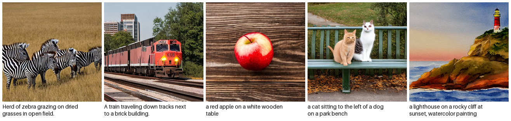

# From Words to Worlds: Text-to-Image with Transformer Encoders + Diffusion

IE 7615 Deep Learning for AI group project. We condition **Stable Diffusion v1.5** on Transformer text embeddings (**CLIP ViT-L/14**, plus **BERT-base** for comparison). Captions and images come from **COCO 2017 val**. Then we study how guidance scale, sampling steps, noise schedulers and encoder choice affect image quality (FID, IS) and prompt alignment (CLIP score).

- **Proposal:** [`docs/proposal.md`](docs/proposal.md)
- **Milestone 1 samples:** [`outputs/milestone1_samples/`](outputs/milestone1_samples/)
- **Milestone 2 results:** [`outputs/milestone2/`](outputs/milestone2/) (training log, sweep logs, grids, baseline samples), summarized [below](#milestone-2-model-integration-and-baseline-results)

## Repo layout
```
configs/config.yaml          every path, model ID, seed and generation setting
src/
  utils.py                   seeding, Drive-aware paths, JSON run logs, image grids
  data.py                    COCO download, caption cleaning, manifest
  preprocess.py              resize + center-crop to 512, [-1, 1] tensors, JPEG cache, Dataset
  embeddings.py              CLIP + BERT batch encoders, cosine similarity, save to .pt
  generate.py                SD 1.5 pipeline (fp16, attention slicing), seeded generate() + JSON sidecar
  bert_adapter.py            BERT -> CLIP-L token projection: training, split by image, baselines
  sweeps.py                  Milestone 2 sweeps (CLIP vs BERT, guidance, scheduler, steps), resumable
  metrics.py                 CLIP score (ViT-B/32) and per-setting summaries
notebooks/
  00_colab_setup.ipynb       mount Drive, clone repo, install, GPU + version check
  01_data_prep.ipynb         download, clean, EDA, manifest + 512px cache to Drive
  02_text_embeddings.ipynb   CLIP/BERT embeddings, similarity checks, save to Drive
  03_baseline_generation.ipynb  5 prompts -> images, grid, prompts.json
  04_bert_projection_training.ipynb  train the BERT -> CLIP adapter, compare it to baselines
  05_milestone2_sweeps.ipynb  100 seeded generations + CLIP score, plots, results zip
docs/proposal.md             1-page Milestone 1 proposal
outputs/milestone1_samples/  committed Milestone 1 images + logs (small files only)
tests/                       fast CPU tests (no model downloads)
```

## Running in Google Colab
1. In Colab, go to **File → Open notebook → GitHub**, paste this repo's URL and open `notebooks/00_colab_setup.ipynb`.
2. Under **Runtime → Change runtime type**, choose **GPU** (a T4 is enough).
3. Run all cells. The first cell of every notebook mounts Drive, clones or pulls the repo to `/content/ie7615-generative-project` and installs `requirements.txt`, so each notebook also runs standalone.
4. Run the notebooks in order: **00 → 01 → 02 → 03** for Milestone 1, then **04 → 05** for Milestone 2. Notebook 04 needs the manifest from 01, and 05 needs the adapter checkpoint from 04. Every step skips work whose output already exists, so it's safe to rerun cells or restart the runtime.
5. **Don't save notebooks back to GitHub from Colab.** That commits all their outputs. Change code locally, and put new settings or paths in `configs/config.yaml`, never in notebook cells.

**Private repo?** Add a Colab secret named `GITHUB_TOKEN` (key icon in the left sidebar) holding a fine-grained, read-only token for this repo. The setup cell uses it for clone and pull, and it never saves the token to `.git/config`.

### Approximate runtimes on a T4
- **01:** the first run downloads the 778 MB image zip and writes 5,000 cached JPEGs to Drive. After that it's seconds.
- **02:** loads CLIP ViT-L/14 and BERT-base, then encodes all 25,012 captions with each.
- **03:** a few seconds per 512×512 image at 30 steps. Each image's JSON sidecar records the measured time and peak VRAM.

## Where artifacts live
Large files never go into git. On Colab they live on Google Drive:
```
/content/drive/MyDrive/ie7615-generative/
  coco/raw/                 annotations + val2017 zips (downloaded once)
  coco/annotations/         captions_val2017.json
  coco/val2017_512/         512x512 center-cropped JPEG cache (about 300 MB)
  coco/manifest.jsonl       one record per image: image_id, file_name, file_path, width, height, captions
  embeddings/               clip_coco_val2017.pt, bert_coco_val2017.pt, embeddings_summary.json
  outputs/                  EDA figures, env logs, Drive mirror of generated samples
```
The original images are extracted to the Colab VM's local disk (`/content/scratch`), which is faster than Drive. They're re-extracted from the zip on Drive whenever the 512px cache needs rebuilding. When you run locally, everything goes under `./data/`. Set `IE7615_ARTIFACT_ROOT` to override the location.

## Reproducibility
- `configs/config.yaml` holds every setting. Notebooks read it instead of hard-coding values.
- `set_seed()` seeds Python, NumPy and torch. Every image is drawn from its own `torch.Generator` seeded with the configured seed (42).
- Every generated image gets a JSON sidecar. It records the prompt, seed, steps, guidance, scheduler, model ID, dtype, elapsed time, peak VRAM, library versions and GPU.
- **Pinned versions:** `requirements.txt` pins diffusers 0.42.1, transformers 5.22.1, accelerate 1.15.0 and safetensors 0.8.0. Colab's own CUDA build of torch is used as-is.
- **Integrity:** COCO zips are checked against their MD5s, and a mismatch stops the run. Each model is pinned to a Hub commit SHA (`models.revisions` in the config), and that SHA is logged in every sidecar.
- **CLIP embeddings:** saved embeddings are encoded without an attention mask, exactly as the SD pipeline encodes prompts, so they can be passed straight back in as `prompt_embeds`.
- **Model IDs** (checked on the Hugging Face Hub 2026-11-02):
  - `stable-diffusion-v1-5/stable-diffusion-v1-5` (the `runwayml/` repo was taken down in 2024 and now redirects here)
  - `openai/clip-vit-large-patch14`
  - `google-bert/bert-base-uncased`

## Milestone 1 prompts
Seed 42, 30 steps, guidance 7.5, PNDM. Two prompts are real COCO captions and three are custom prompts of increasing difficulty. The second table previews the later analysis.

**Real COCO captions**

| id | prompt | source |
|---|---|---|
| p1_coco_zebra | Herd of zebra grazing on dried grasses in open field. | COCO image 508586 |
| p2_coco_train | A train traveling down tracks next to a brick building. | COCO image 201148 |

**Custom prompts**

| id | prompt | difficulty |
|---|---|---|
| p3_single_object | a red apple on a white wooden table | single object |
| p4_spatial | a cat sitting to the left of a dog on a park bench | multiple objects + spatial relation |
| p5_style | a lighthouse on a rocky cliff at sunset, watercolor painting | scene + style descriptor |

### Results



These come from one run with seed 42: a Colab T4, Python 3.13.16, torch 2.11.0+cu130, about 6.5–9 s per image and 3.4 GB peak VRAM. No image was flagged by the safety checker.

| Prompt | Result |
|---|---|
| p1 zebra | Faithful to the caption (see `coco_real_vs_generated.png`). |
| p2 train | Train and tracks are correct, but it shows modern towers instead of a brick building. The modifier was dropped. |
| p3 apple | The object is right, but the table is dark wood, not white. The attribute was not bound to its object. |
| p4 cat + dog | Two cats and no dog, so one object replaced another, and the left/right relation was lost. |
| p5 lighthouse | The watercolor style was applied well. |

The failures in p2–p4 are the known compositional limits of SD 1.5's CLIP conditioning. Later milestones will measure them with guidance-scale sweeps and CLIP score.

## Milestone 2: model integration and baseline results
Notebook 04 trains the BERT → CLIP adapter. Notebook 05 runs 100 seeded generations (the same 5 prompts, seed 42) across four sweeps and scores every image with CLIP score. All files are in [`outputs/milestone2/`](outputs/milestone2/). One run on 2026-11-18: a Colab T4, Python 3.13.16, torch 2.14.1+cu130, diffusers 0.42.1, transformers 5.22.1, 3.71 GB peak VRAM. No image was flagged by the safety checker.

### BERT → CLIP adapter
SD 1.5's U-Net cross-attends to CLIP ViT-L/14 hidden states (`[77, 768]`). BERT-base has the same shape but a different embedding space and tokenizer, so we train an adapter that maps BERT's last hidden state into CLIP space. The architecture is Linear → LayerNorm → GELU, then 2 pre-norm Transformer encoder layers (8 heads, feed-forward 3072, dropout 0.1), then Linear. The loss is `MSE + 0.5 · (1 − cosine)`, trained for 15 epochs with AdamW (lr 3e-4, weight decay 0.01, cosine decay) and batch size 128.

- **Data:** 25,012 caption pairs from COCO 2017 val. The split is by image (seeded), so all captions of an image fall on one side: 22,500 training pairs from 4,498 images and 2,502 validation pairs from 500 images.
- **No leakage:** the two images whose captions are generation prompts (508586, 201148) are excluded from both sides.
- **Epoch selection:** by validation loss on content tokens (CLIP BOS through EOS). Padding positions look alike for every caption and would dominate an all-token metric.

| Method (validation) | MSE, content | Cosine, content | MSE, all 77 | Cosine, all 77 |
|---|---|---|---|---|
| Mean CLIP embedding (per position) | 0.7425 | 0.4786 | 0.7349 | 0.5207 |
| Linear map per position | 0.6822 | 0.5957 | 0.5236 | 0.6988 |
| **Adapter (epoch 15)** | **0.3755** | **0.7815** | **0.2507** | **0.8649** |

Validation loss fell every epoch, from 0.7421 at epoch 1 to 0.4847 at epoch 15, the best epoch. Train and validation content cosine stay close (0.7807 vs 0.7815), so the adapter is not overfitting. Log and curve: [`bert_training_log.csv`](outputs/milestone2/logs/bert_training_log.csv), [`bert_training_curve.png`](outputs/milestone2/logs/bert_training_curve.png).

### Sweeps
Each setting is scored over the 5 prompts with **CLIP score** = 100 · max(cos(image, text), 0), using **CLIP ViT-B/32**. That's a different checkpoint from the ViT-L/14 encoder SD conditions on, so the generator isn't scored by its own text encoder. The table shows the mean ± standard deviation over the 5 prompts, plus mean seconds per image.

| Sweep | Setting | CLIP score | s / image |
|---|---|---|---|
| Encoder (PNDM, 30 steps, s = 7.5) | CLIP (native) | 32.56 ± 3.67 | 6.76 |
| | BERT → adapter | 28.98 ± 5.59 | 6.31 |
| Guidance scale s (CLIP, PNDM, 30 steps) | 1.0 | 31.37 ± 4.46 | 3.98 |
| | 3.0 | 32.17 ± 2.63 | 6.59 |
| | 5.0 | 32.39 ± 2.49 | 6.60 |
| | 7.5 | 32.56 ± 3.67 | 6.60 |
| | 10.0 | 32.59 ± 3.27 | 6.61 |
| | 15.0 | 32.10 ± 4.09 | 6.59 |
| Scheduler (CLIP, 30 steps, s = 7.5) | PNDM | 32.56 ± 3.67 | 6.60 |
| | DDIM | 32.72 ± 3.15 | 6.40 |
| | DPM-Solver++ | 32.89 ± 1.77 | 6.38 |
| | Euler | 32.83 ± 2.13 | 6.38 |
| Steps, DDIM (CLIP, s = 7.5) | 10 / 20 / 30 / 50 | 33.05 / 32.29 / 32.72 / 32.37 | 2.29 / 4.34 / 6.39 / 10.49 |
| Steps, DPM-Solver++ (CLIP, s = 7.5) | 10 / 20 / 30 / 50 | 33.05 / 32.70 / 32.89 / 33.27 | 2.29 / 4.33 / 6.37 / 10.46 |

Guidance 1.0 runs one U-Net pass per step instead of two, which is why it's faster. Grids: [`grid_clip_vs_bert.jpg`](outputs/milestone2/samples/grid_clip_vs_bert.jpg), [`grid_cfg_sweep.jpg`](outputs/milestone2/samples/grid_cfg_sweep.jpg), [`grid_scheduler_sweep.jpg`](outputs/milestone2/samples/grid_scheduler_sweep.jpg), [`grid_steps_sweep.jpg`](outputs/milestone2/samples/grid_steps_sweep.jpg). Every run is in [`sweep_runs_log.csv`](outputs/milestone2/logs/sweep_runs_log.csv).

**CLIP vs BERT, per prompt**

| Prompt | CLIP | BERT → adapter | Difference |
|---|---|---|---|
| p1 zebra | 32.39 | 29.65 | +2.74 |
| p2 train | 27.98 | 28.92 | −0.94 |
| p3 apple | 30.18 | 36.33 | −6.15 |
| p4 cat + dog | 35.22 | 29.45 | +5.77 |
| p5 lighthouse | 37.04 | 20.58 | +16.46 |

### Observations
- **The adapter learns the mapping, but not closely enough for SD.** It clearly beats both baselines (content cosine 0.78 vs 0.60). Yet every BERT-conditioned image shows heavy artifacts: oversaturated colour, noise-like texture, smeared shapes. The U-Net was trained on exact CLIP states, so a 0.78-cosine approximation is still off-distribution for it.
- **CLIP score misses image quality.** CLIP wins on mean score by 3.6 points, but the per-prompt gap ranges from −6.2 to +16.5, and BERT wins on two prompts. On p3, BERT scores 36.33 against CLIP's 30.18 with an image that looks like a tomato on a plate. CLIP score measures text–image alignment, not fidelity, which is why Milestone 3 adds FID and IS.
- **Guidance:** s = 1.0 is the only clearly worse setting (31.37), and its images are washed out and nearly grey. From 3 to 15, the means lie within 0.5 of each other, well inside the spread across prompts. Visually, s = 7.5–10 looks best. At s = 15, colours oversaturate (purple-tinted zebras, a cartoon-coloured train, a blown-out sun).
- **Schedulers:** all four score within 0.33 of each other. DPM-Solver++ has the smallest spread across prompts (± 1.77).
- **Steps:** CLIP score doesn't rise with steps, while time grows linearly (2.3 s at 10 steps vs 10.5 s at 50). DPM-Solver++ keeps the same composition from 10 to 50 steps. DDIM's composition shifts: p4 goes from one cat at 10–30 steps to two cats at 50, and at 10 steps p3 puts the apple on a plate.
- **Compositional failures persist under every setting.** p4 never shows a dog: it's one cat at s = 3–5 and two cats at s ≥ 7.5. p2's brick building is mostly missing, though it appears at DPM-Solver++ 30 and 50 steps. These are limits of SD 1.5's conditioning, not of sampling.
- **Reproducibility:** settings that recur across sweeps were generated independently and compared pixel by pixel. There are 15 groups: for each of the 5 prompts, the default image from the baseline, guidance and scheduler sweeps, plus DDIM and DPM-Solver++ at 30 steps from the scheduler and step sweeps. All 15 were identical (max absolute pixel difference 0).

### Limits and next steps (Milestone 3)
These results use 5 prompts and one seed, so the differences inside the guidance, scheduler and step sweeps are not statistically meaningful. Only the adapter-vs-baseline gap and the visual failure modes are firm findings. Milestone 3 adds FID and Inception Score on a larger set of COCO captions, several seeds per prompt, and a closer look at the adapter's off-distribution artifacts.

## Local development (optional, CPU only)
```bash
uv venv .venv && uv pip install --python .venv/bin/python torch torchvision --index-url https://download.pytorch.org/whl/cpu
uv pip install --python .venv/bin/python -r requirements.txt pytest
.venv/bin/python -m pytest -q
```
